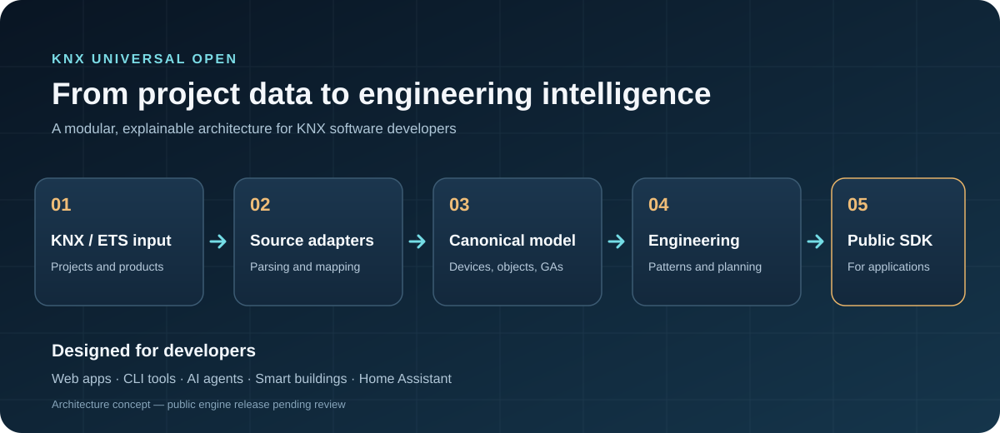
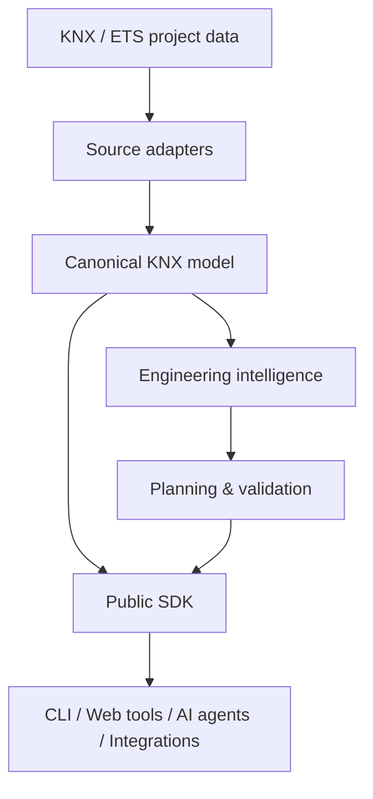

<div align="center">

# KNX Universal Open

### Open-source KNX engineering infrastructure

**Understand KNX projects. Discover device functions. Build better automation tools.**

[](docs/ROADMAP.md)
[](https://github.com/fwelpo3/knx-universal-open/issues)
[](CONTRIBUTING.md)

[**Explore the architecture**](docs/ARCHITECTURE.md) · [**Read the roadmap**](docs/ROADMAP.md) · [**Contribute**](CONTRIBUTING.md) · [**Join the discussion**](https://github.com/fwelpo3/knx-universal-open/issues)

</div>

---



## One foundation. Many KNX applications.

KNX Universal Open is an open-source initiative to create a **reusable, headless KNX engineering engine**. The goal is to make KNX project understanding, device intelligence, and engineering workflows accessible to developers building CLIs, web applications, integrations, and AI-assisted tools.

> **Early public source release:** The TypeScript platform source and characterization tests are now available. This is a development snapshot, not a production-ready release.

### What we're building

| 🧩 KNX project understanding | 🔎 Device intelligence | 🔗 Engineering automation |
| :--- | :--- | :--- |
| Structured KNX/ETS data, devices, topology, communication objects and group addresses. | Explainable recognition using DPTs, object flags, channels and device patterns. | Planning and validation of group addresses, links and engineering changes. |

| 🧱 Reusable SDK | 🧪 Deterministic validation | 🌐 Integrations |
| :--- | :--- | :--- |
| Stable interfaces for use beyond a single application. | Testable rules, evidence-backed matches and safe handling of unknowns. | Future adapters for Node.js, CLI, servers, Home Assistant and developer tools. |

## Architecture at a glance



The design separates file formats, runtime dependencies, and engineering logic so that each part can be developed and tested independently. See [architecture](docs/ARCHITECTURE.md).

## Current source and setup

The repository includes source code in `packages/`, characterization tests in `tests/`, scripts, examples and architecture documentation.

Requirements: Node.js >= 22.6 and npm.

```bash
git clone https://github.com/fwelpo3/knx-universal-open.git
cd knx-universal-open
npm ci
npm run verify
```

The verification command runs TypeScript type checking, characterization tests and architecture-boundary checks. The project is not yet published as an npm package (`private: true` in `package.json`).

## Project status

- [x] Initial TypeScript engine and SDK source published
- [x] Characterization tests and verification scripts published
- [ ] Independent CI verification on GitHub Actions
- [ ] Complete dependency, rights and security review
- [ ] Document supported feature maturity and limitations
- [ ] MIT license added
- [ ] First tagged release

**License:** [MIT](LICENSE). Check ownership and third-party rights before contributing files or datasets.

See the [roadmap](docs/ROADMAP.md) for planned work.

## Why another KNX project?

Existing projects such as [XKNX Project](https://github.com/XKNX/xknxproject) specialize in project parsing, while [KNXUltimate](https://github.com/Supergiovane/KNXUltimate) addresses KNX communication. Our **intended focus** is a reusable engineering layer: explainable device interpretation, source-independent KNX models, and group-address/link planning. This is a direction for development, **not a claim of feature superiority or current parity**.

## For developers

Interested in KNX, ETS project formats, smart building software, device classification, or open engineering tools?

1. Read the [architecture](docs/ARCHITECTURE.md) and [roadmap](docs/ROADMAP.md).
2. Check [issues](https://github.com/fwelpo3/knx-universal-open/issues) for proposed work.
3. Read [contribution guidelines](CONTRIBUTING.md).
4. Propose features, integrations, tests, documentation, or manufacturer-neutral device patterns.

**Looking for collaborators.** Independent developers, KNX integrators, open-source maintainers and smart-building researchers are welcome.

## Contribute in three ways

| Build | Validate | Document |
| :-- | :-- | :-- |
| Propose adapters, SDK APIs and developer tools. | Contribute synthetic KNX fixtures and edge-case tests. | Clarify DPT behavior, project models and integration guides. |

Start with [the collaboration discussion](https://github.com/fwelpo3/knx-universal-open/issues/1).

## Community & contact

- **Questions and collaborations:** [Open a GitHub issue](https://github.com/fwelpo3/knx-universal-open/issues/new)
- **Project discussion:** GitHub Discussions (link will be added when enabled)
- **Discord:** Planned; no invitation link available yet

## Licensing and third-party materials

The intended licensing model is **Apache-2.0**, subject to a source and rights audit. **No license is granted for unpublished code.** KNX, ETS and manufacturer names are trademarks of their respective owners. No third-party ETS binaries, manufacturer databases, private project files or license materials are distributed by this repository.

This is an independent community initiative and is **not affiliated with or endorsed by KNX Association**.

---

<div align="center">

**Build an open KNX engineering ecosystem — together.**

[Roadmap](docs/ROADMAP.md) · [Contribution guide](CONTRIBUTING.md) · [Security](SECURITY.md)

</div>
