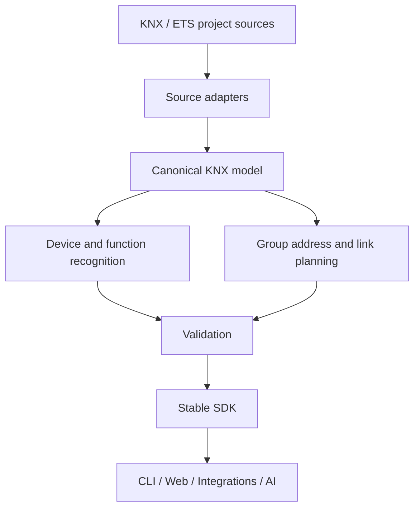

# Architecture

KNX Universal Open is designed as headless, reusable KNX engineering infrastructure.

## Module boundaries

- **knx-core:** KNX data types, addresses, DPTs
- **knx-model:** source-independent canonical project representation
- **knx-ets:** ETS import and source adapters
- **knx-engineering:** explainable pattern recognition and planning
- **knx-sdk:** stable consumer API

These describe the architecture of the existing **private** platform; public source modules have not yet been transferred.

## Design rules

- Keep runtime and UI dependencies separate from engineering logic.
- Preserve evidence behind all automatic recognition.
- Mark ambiguous matches as candidates, never silently bind them.
- Use synthetic or redistribution-cleared fixtures.
- Do not redistribute proprietary ETS binaries or private manufacturer resources.

See [Roadmap](ROADMAP.md).
